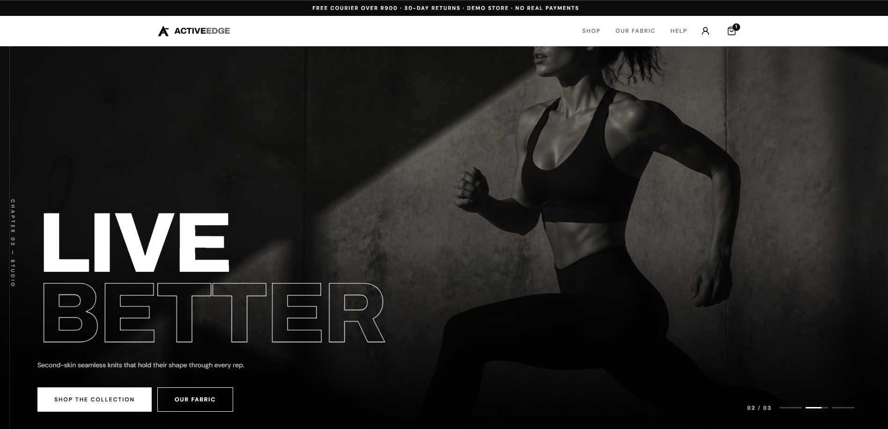

  
Cape Peninsula University of Technology · Project Presentation 3

  <h1>Jonathan Scott Munday</h1>
  
Agile development portfolio — documenting my contribution to ActiveEdge through user-centred design, wireframing, frontend implementation and Supabase database configuration.

  

    October 2026 assessment
    ActiveEdge · Performance Sportswear
    Individual evidence & reflection
  

  

    <a class="primary" href="#assessment-evidence">Explore assessment evidence</a>
    <a href="https://active-edge-website.vercel.app/" target="_blank" rel="noopener">View ActiveEdge website ↗</a>
  

  <a href="#overview">Overview</a>
  <a href="#contribution">My contribution</a>
  <a href="#team-charter">01 Team charter</a>
  <a href="#user-stories">02 User stories</a>
  <a href="#product-backlog">03 Product backlog</a>
  <a href="#sprint-backlog">04 Sprint backlog</a>
  <a href="#agile-logbook">05 Agile logbook</a>
  <a href="#showcase">Project showcase</a>
  <a href="#professional-development">Professional development</a>

  
05Agile assessment categories

  
100Total available marks

  
50 / 50Evidence and reflection weighting

  
UX → UI → Code → DataMy reported contribution areas

## Portfolio overview

This portfolio presents evidence of my learning and individual contribution to the ActiveEdge project. It is organised around the five assessment categories in the October 2026 Project Presentation 3 brief: Agile Team Charter, User Stories and Tasks, Product Backlog, Sprint Backlog and Agile Logbook.

The assessment allocates **10 marks to evidence and 10 marks to reflection in each category**. The purpose of this portfolio is therefore not only to display project artefacts, but also to explain what the artefacts demonstrate about my development, decisions and learning.

  <strong>How to read this portfolio</strong>
  
Each assessment section separates the project evidence from my individual reflection. Where an original team artefact or dated record still needs to be attached, the page contains a clearly labelled placeholder. These placeholders must be replaced with genuine project records before final submission.

### The four e-portfolio principles

  
<h4>01 · Collect</h4>
Bring together project artefacts such as wireframes, design iterations, code evidence, database screenshots and Agile records.

  
<h4>02 · Select</h4>
Choose evidence that directly demonstrates my contribution and the team's development process.

  
<h4>03 · Reflect</h4>
Explain what the evidence demonstrates, what I learned and where my approach could improve.

  
<h4>04 · Connect</h4>
Show how user needs, design decisions, development tasks and the resulting product relate to one another.

## Project overview — ActiveEdge

**ActiveEdge** is a sustainable performance sportswear concept developed around activewear for fitness-conscious South Africans. The original team charter describes the intended offering as performance activewear made from recycled and eco-certified materials, with products such as leggings, sports bras, T-shirts, shorts and outerwear.

The live project website presents the brand, product collections, best-selling products, fabric information, delivery and returns information, and a shopping interface. The live site labels itself as a **demo store with no real payments**; this portfolio therefore treats it as a demonstration product experience, not as evidence of completed live payment processing.

  

    

      <h4>Project identity</h4>
      
<strong>Project:</strong> ActiveEdge — Performance Sportswear

      
<strong>Course shown in team charter:</strong> PRP372S

      
<strong>Assessment:</strong> Project Presentation 3 · October 2026

      
<strong>Project website:</strong> <a href="https://active-edge-website.vercel.app/" target="_blank" rel="noopener">active-edge-website.vercel.app</a>

    

    

      <h4>Project purpose</h4>
      
To develop a digital brand and shopping experience for performance sportswear, communicating the product offering and its sustainability positioning through a coherent website experience.

      
<strong>Backend platform used in my contribution:</strong> Supabase.

      
<strong>Frontend framework/language:</strong> React-Native.

    

  

  <strong>Project screenshot — ActiveEdge homepage</strong>
  .
  Save as <code>assets/images/activeedge-homepage.png</code>, then replace this placeholder with: <code></code>.

## My individual contribution

I joined the ActiveEdge project as an additional team member after the original team charter had already been prepared. My contribution was focused on the product's digital experience and technical implementation, spanning design and development work.

### UX/UI design and wireframing

I was responsible for developing the website wireframes, working from **low-fidelity to mid-fidelity**. This involved translating the product concept into page structures and interface layouts, considering the placement of content, navigation and the way a visitor would move through the website. I also contributed to product design decisions to help shape a consistent website experience for the ActiveEdge brand.

### Frontend development

I contributed to the frontend code by implementing and refining interface elements and touching up existing frontend work. This connected the design stage to the working website and required attention to the visual presentation and consistency of the user interface.

### Backend and database configuration

I worked with **Supabase** on the backend, including setting up the database and configuring columns. This gave me practical exposure to the data layer supporting the application and to the relationship between the information stored in the backend and the experience presented through the frontend.

  
My contribution<h4>01 · Design</h4>
Low- to mid-fidelity wireframes and product design.

  
My contribution<h4>02 · Frontend</h4>
Frontend implementation, code changes and interface refinement.

  
My contribution<h4>03 · Backend</h4>
Supabase database setup and column configuration.

  <strong>Scope and attribution:</strong> This portfolio describes my individual contribution as an additional team member. It does not imply that I authored the original team charter or that I completed every part of the group project independently. Where team-level evidence is shown, my own role is identified separately.

## Assessment evidence at a glance

| Assessment category | Evidence marks | Reflection marks | Portfolio section |
|---|---:|---:|---|
| Agile Team Charter | 10 | 10 | [Section 01](#team-charter) |
| User Stories and Tasks | 10 | 10 | [Section 02](#user-stories) |
| Product Backlog | 10 | 10 | [Section 03](#product-backlog) |
| Sprint Backlog | 10 | 10 | [Section 04](#sprint-backlog) |
| Agile Logbook | 10 | 10 | [Section 05](#agile-logbook) |
| **Total** | **50** | **50** | **100 marks** |

---

## 01 — Agile Team Charter

The team's founding agreement: its purpose, values, roles, communication approach, milestones and ways of working.

### Evidence

The original ActiveEdge Team Charter was prepared on **1 April 2026**. It defines the team's purpose and vision, product concept, founding team roles, core values, Agile principles, communication plan, SMART milestones, Kanban-inspired approach, working agreements and decision-making process.

The charter identifies WhatsApp for day-to-day updates, Google Meet for meetings and Google Drive for shared documents. It records a weekly Monday check-in and describes the team's use of a shared Trello board to track work. These are the working arrangements documented in the original charter.

**Original artefact:** [Download the original ActiveEdge Team Charter (DOCX)](assets/documents/ActiveEdge_Team_Charter.docx).

  <strong>Membership context</strong>
  
I joined ActiveEdge as an additional member after the original charter had been created. The original document is retained as the team's founding agreement and is not presented as a document I authored. My later contribution is documented in the individual-contribution section of this portfolio.

  <strong>Original Agile Team Charter — PDF Evidence</strong>
  

    The original Team Charter was created before I joined the project.
    It is included here as supporting evidence of the team's original
    objectives, roles, values and working agreements.
  

  <a href="documents/old-team-charter-evidence.pdf" target="_blank">
    View Original Team Charter (PDF)
  </a>

### Individual reflection

  <h3>Reflection — Agile Team Charter</h3>
  
Because I joined ActiveEdge after the original charter had been prepared, I used it as a reference point for understanding the team's purpose and agreed way of working rather than claiming to have co-created it. Reviewing the document helped me understand the product direction, the responsibilities initially allocated across the founding team, and the expectations the team had set for communication and accountability.

  
The charter's emphasis on respect, transparency, accountability, trust and a learning mindset is relevant to the type of work I contributed. My responsibilities crossed design and development, so progress depended on understanding the wider product direction and communicating how design decisions related to implementation. The documented communication channels and weekly check-ins also show why keeping the team informed and making blockers visible are important in collaborative work.

  
The Kanban-inspired approach described in the charter provided a framework for thinking about work as visible tasks with ownership and progress, rather than treating the finished website as one large activity. This is particularly relevant when design, frontend refinement and backend configuration need to fit together.

  
My main learning is that a team charter is useful when it is actively referred to during the project, not simply created as a document for submission. Joining after the original charter also made me aware of the importance of onboarding: an additional member needs to understand the team's objectives, communication norms and current responsibilities before contributing effectively. In future projects, I would make that onboarding process explicit and ensure that the team has a shared understanding of any role changes.

  
<strong>Development insight:</strong> The charter gave me context for contributing within an existing team structure. It reinforced that technical work is more effective when it is aligned with shared goals, clear communication and accountability.

---

## 02 — User Stories and Tasks

User stories express a feature from the end user's perspective; tasks break the work into actionable steps.

### Evidence

The following are **draft user stories derived from the visible ActiveEdge website and project concept**. They provide a structured portfolio representation, but they must be checked against the team's actual Trello cards or original requirements before being described as the team's approved user stories. Replace or amend them where the Trello board differs.

  <strong>Evidence validation required:</strong> These stories are reconstructed for portfolio organisation from the current product experience. They are not represented as verbatim extracts from the Trello board.

<table>
  <thead><tr><th>ID</th><th>User story</th><th>Candidate tasks</th><th>Validation</th></tr></thead>
  <tbody>
    <tr><td>US-01</td><td>As a visitor, I want to browse the available sportswear collections so that I can find products relevant to my training needs.</td><td>Plan collection navigation in the wireframes; design the collection layout; implement/refine the collection interface; verify that product information is presented consistently.</td><td>Confirm in Trello</td></tr>
    <tr><td>US-02</td><td>As a visitor, I want to see product names, prices and available product information so that I can compare items before making a decision.</td><td>Identify required product information; include product content in the wireframe; refine the product presentation in the frontend; confirm the relevant data fields with the backend structure.</td><td>Confirm in Trello</td></tr>
    <tr><td>US-03</td><td>As a visitor, I want to understand the brand's fabric and sustainability information so that I can evaluate whether the product offering aligns with my preferences.</td><td>Allocate a clear place for brand/fabric content in the page structure; design the information section; implement and refine its presentation.</td><td>Confirm in Trello</td></tr>
    <tr><td>US-04</td><td>As a visitor, I want to find delivery and returns information so that I can understand the store's stated service conditions.</td><td>Identify where service information belongs in the user journey; include it in the page structure; ensure the information is readable and easy to locate.</td><td>Confirm in Trello</td></tr>
  </tbody>
</table>

  <strong>Evidence screenshot — Trello user stories and tasks</strong>
  Insert a screenshot of the actual Trello board showing user-story cards, task breakdowns, assignees or statuses. If the board is accessible to the lecturer, add its share link here as well.
  Suggested filename: <code>assets/images/trello-user-stories.png</code>.

  <strong>Evidence screenshot — low- and mid-fidelity wireframes</strong>
  Add the actual wireframes that show how the page structure and user journey were translated into interface layouts.
  Suggested filenames: <code>assets/images/wireframes-low-fidelity.png</code> and <code>assets/images/wireframes-mid-fidelity.png</code>.

### Individual reflection

  <h3>Reflection — User Stories and Tasks</h3>
  
My work on the ActiveEdge wireframes required me to think about the website from the visitor's perspective before focusing on the implementation. Moving from low-fidelity to mid-fidelity wireframes helped turn a broad product idea into more considered page structures and interface layouts. This process highlighted that decisions about navigation, content hierarchy and product presentation affect how easily a visitor can understand and use a website.

  
My contribution then extended into frontend implementation and refinement. This gave me a practical connection between a design decision and the development work needed to represent it in the interface. Working on the Supabase database setup also made it important to consider the information that the application needs to store and how the backend data structure relates to what the user sees.

  
The user-story approach helps connect these activities to a clear user outcome. A story should explain why a feature matters, while its tasks should make the work small and understandable enough to plan and complete. I can see how this creates a useful link between the wireframes, the development tasks and the final website.

  
One area I would strengthen in future work is traceability. Each important design or development task should link to an agreed user story and have a clear completion condition. This makes it easier for the team to check whether the work addresses the user's need rather than only whether a screen or code change has been produced.

  
<strong>Development insight:</strong> User stories help keep design and implementation focused on the people using the product. My experience reinforced the value of connecting user needs, interface decisions and technical tasks instead of treating them as separate activities.

---

## 03 — Product Backlog

The product backlog is the prioritised list of product work, including features, improvements and fixes.

### Evidence

The following table organises the work areas that can be supported by the information currently available. It is a **portfolio draft**, not a claim that these were the exact backlog items or priority order recorded by the team. Check the names, priority and status against the actual Trello board and update the table before submission.

<table>
  <thead><tr><th>Backlog ID</th><th>Work item</th><th>Product value</th><th>Priority</th><th>Contribution / status</th></tr></thead>
  <tbody>
    <tr><td>PBI-01</td><td>Low-fidelity website wireframes</td><td>Establish page structure and an early view of the visitor journey.</td><td>Confirm from Trello</td><td>Wireframing contribution reported by me.</td></tr>
    <tr><td>PBI-02</td><td>Mid-fidelity wireframes and product design</td><td>Develop the initial layouts into more considered interface designs.</td><td>Confirm from Trello</td><td>Design contribution reported by me.</td></tr>
    <tr><td>PBI-03</td><td>Frontend implementation and refinement</td><td>Translate the design into a website interface and refine the existing frontend.</td><td>Confirm from Trello</td><td>Frontend contribution reported by me; exact files/tasks to attach.</td></tr>
    <tr><td>PBI-04</td><td>Supabase database setup and column configuration</td><td>Establish the backend data structure needed by the application.</td><td>Confirm from Trello</td><td>Backend contribution reported by me; actual schema evidence to attach.</td></tr>
    <tr><td>PBI-05</td><td>Product and collection information presentation</td><td>Help visitors understand the products and navigate the catalogue.</td><td>Confirm from Trello</td><td>Visible in the live site; map to the team's original backlog item.</td></tr>
    <tr><td>PBI-06</td><td>Fabric, delivery and returns information</td><td>Make supporting brand and service information discoverable.</td><td>Confirm from Trello</td><td>Visible in the live site; confirm original task ownership/status.</td></tr>
  </tbody>
</table>

  <strong>Evidence screenshot — actual product backlog</strong>
  Add a Trello screenshot or export showing the actual product backlog, priority order and statuses. If the board contains multiple lists, capture enough of the board to show the organisation and context.
  Suggested filename: <code>assets/images/trello-product-backlog.png</code>.

  <strong>Evidence screenshot — Supabase database structure</strong>
  Add a screenshot from the Supabase dashboard showing the relevant table names and columns. Hide any API keys, service-role keys, passwords, personal data or other secrets before uploading.
  Suggested filename: <code>assets/images/supabase-schema.png</code>. Never publish credentials or private customer data.

### Individual reflection

  <h3>Reflection — Product Backlog</h3>
  
The ActiveEdge work helped me understand how a product backlog can connect the overall product direction to the individual activities needed to build it. My own contribution covered several related work areas: wireframing, product design, frontend implementation and Supabase database configuration. Looking at these activities together makes it clear that a website is not developed through visual design alone; the interface and the underlying data structure also need to support the product experience.

  
The backlog is useful because it gives the team one place to understand what work is required and why it matters. For example, wireframes help establish the structure of the experience, frontend tasks turn that structure into an interface, and database tasks support the information the application needs to work with. Organising these activities as backlog items makes dependencies and the broader purpose of each task easier to see.

  
My learning is that backlog quality depends on clarity and prioritisation. An item should describe a meaningful outcome rather than remain a vague instruction. Priorities should also be visible and agreed by the team so that effort is directed towards the most important product needs. I would improve this process by ensuring that each design and development item has an owner, an agreed priority, a clear acceptance condition and a link to the related user story.

  
The table above is structured from the contribution and product information available to me; the team's actual priority order and original backlog wording must be confirmed against Trello. Keeping that distinction is important because a portfolio should accurately represent the team's decisions rather than imply that a reconstructed list is the original record.

  
<strong>Development insight:</strong> A product backlog makes the connection between product goals and technical work visible. It also provides a stronger basis for planning when design, frontend and backend tasks depend on one another.

---

## 04 — Sprint Backlog

The sprint backlog records the work selected for a particular sprint and the plan for achieving its sprint goal.

### Evidence

The assessment distinguishes the sprint backlog from the product backlog: the sprint backlog is the actionable plan for the work selected to achieve a sprint goal. I have not been provided with the team's sprint dates, sprint goal or exact selected Trello cards. The structure below is therefore a place to insert the **actual sprint record**, not a fabricated sprint report.

  

    
<strong>Sprint number / name</strong>
[INSERT ACTUAL SPRINT]

    
<strong>Sprint dates</strong>
[INSERT VERIFIED START AND END DATES]

    
<strong>Sprint goal</strong>
[INSERT THE TEAM'S AGREED SPRINT GOAL]

    
<strong>Source</strong>
[INSERT TRELLO BOARD / LIST / CARD LINK]

  

<table>
  <thead><tr><th>Task ID</th><th>Selected sprint task</th><th>Assignee</th><th>Status / outcome</th><th>Evidence</th></tr></thead>
  <tbody>
    <tr><td>[ID]</td><td>[INSERT EXACT TASK FROM TRELLO]</td><td>[NAME]</td><td>[VERIFIED STATUS]</td><td>[CARD / SCREENSHOT]</td></tr>
    <tr><td>[ID]</td><td>[INSERT EXACT TASK FROM TRELLO]</td><td>[NAME]</td><td>[VERIFIED STATUS]</td><td>[CARD / SCREENSHOT]</td></tr>
    <tr><td>[ID]</td><td>[INSERT EXACT TASK FROM TRELLO]</td><td>[NAME]</td><td>[VERIFIED STATUS]</td><td>[CARD / SCREENSHOT]</td></tr>
  </tbody>
</table>

  <strong>Evidence screenshot — actual sprint backlog</strong>
  Add a Trello screenshot showing the sprint list, selected tasks, assignees and statuses. Include the sprint goal and date range in the portfolio text above.
  Suggested filename: <code>assets/images/trello-sprint-backlog.png</code>.

### Individual reflection

  <h3>Reflection — Sprint Backlog</h3>
  
My contribution to ActiveEdge involved work that moved between design and implementation. This made the purpose of sprint planning particularly clear to me: a broad product requirement needs to be translated into smaller tasks that can be understood, assigned, tracked and reviewed within a defined period. Wireframing, product design, frontend refinement and backend database configuration are related, but each involves different activities and evidence of completion.

  
A sprint backlog can help the team make those activities manageable. For design work, a task can produce a specific wireframe or design revision. For frontend work, it can identify the interface element that needs to be implemented or refined. For backend work, it can describe the required database configuration and the expected structure. Breaking the work down in this way makes progress easier to communicate and reduces ambiguity between people working on connected parts of the product.

  
This project also reinforced the importance of handovers and dependencies. A frontend change may rely on an agreed design, while the way information is displayed may depend on the fields configured in the database. The sprint plan should make these relationships visible so that work can be completed in a sensible order and issues can be raised early.

  
For future sprints, I would make sure every selected task has a clear owner, a definition of done and a realistic scope. I would also review the board during the sprint rather than relying only on an end-of-sprint status. The actual sprint goal, dates and selected cards should accompany this reflection so that the evidence shows how the team's plan was applied in practice.

  
<strong>Development insight:</strong> Sprint planning helps turn a broad product backlog into a focused, time-bound plan. It is especially valuable when design, frontend and backend activities need to coordinate towards one product outcome.

---

## 05 — Agile Logbook

The logbook records project activity over time, including stand-ups, sprint planning, progress, blockers and retrospectives.

### Evidence

The sequence below summarises the work areas I have confirmed from my own contribution. Exact dates, daily stand-up notes, blockers and retrospective decisions were not supplied, so they are intentionally left for completion from genuine project records.

<table>
  <thead><tr><th>Date</th><th>Work area / activity</th><th>My involvement</th><th>Outcome / learning</th><th>Supporting evidence</th></tr></thead>
  <tbody>
    <tr><td>[INSERT DATE]</td><td>Low-fidelity wireframing</td><td>Developed initial website wireframes and page structures.</td><td>[ADD VERIFIED OUTCOME / FEEDBACK]</td><td>[WIREframe / TRELLO CARD]</td></tr>
    <tr><td>[INSERT DATE]</td><td>Mid-fidelity wireframing and product design</td><td>Refined the layouts and contributed to product design.</td><td>[ADD VERIFIED OUTCOME / DESIGN CHANGE]</td><td>[DESIGN FILE / SCREENSHOT]</td></tr>
    <tr><td>[INSERT DATE]</td><td>Frontend implementation and refinement</td><td>Worked on frontend code and interface improvements.</td><td>[ADD VERIFIED COMPONENT / CHANGE]</td><td>[COMMIT / SCREENSHOT]</td></tr>
    <tr><td>[INSERT DATE]</td><td>Supabase database configuration</td><td>Worked on database setup and column configuration.</td><td>[ADD VERIFIED TABLES / COLUMNS / OUTCOME]</td><td>[SUPABASE SCREENSHOT]</td></tr>
    <tr><td>[INSERT DATE]</td><td>Review / testing / retrospective</td><td>[ADD YOUR ACTUAL PARTICIPATION]</td><td>[ADD ACTUAL FEEDBACK, BLOCKER OR ACTION]</td><td>[MEETING NOTE / TRELLO CARD]</td></tr>
  </tbody>
</table>

  <strong>Evidence screenshot — Trello activity / Agile Logbook</strong>
  Add a screenshot of the actual board activity or logbook entries. Ideally show dates, task movement, completed work and any recorded blockers or retrospective actions.
  Suggested filename: <code>assets/images/agile-logbook.png</code>.

  <strong>Evidence screenshot — sprint planning or retrospective</strong>
  Add genuine meeting notes, a retrospective board, or a screenshot of the team's recorded planning discussion. Do not create backdated notes for meetings that were not recorded.
  Suggested filename: <code>assets/images/agile-retrospective.png</code>.

### Individual reflection

  <h3>Reflection — Agile Logbook</h3>
  
My ActiveEdge contribution covered multiple stages of the development process: preparing low- to mid-fidelity wireframes, contributing to product design, refining frontend code and working on the Supabase database structure. Reviewing these activities as a sequence helps me understand how a product moves from an initial concept towards a working digital experience.

  
The logbook is important because the final website only shows the result at a particular point in time. It does not, by itself, explain the decisions, revisions, task progress or collaboration that took place during development. A chronological record can show how the work changed, what was completed, what needed attention and how the team responded to issues.

  
For my own work, recording design iterations would make it easier to explain why a wireframe changed and how that change affected the frontend. Recording database configuration would also help connect the backend work to the data requirements of the interface. This creates a clearer record of the relationship between design, implementation and the data layer.

  
One improvement I would carry into future projects is to keep the logbook up to date as work happens. Dates, task references, decisions, blockers and outcomes are much more reliable when recorded close to the activity. They also make sprint reviews and retrospectives more useful because the team can reflect on actual events rather than depending on memory at the end of a project.

  
<strong>Development insight:</strong> An Agile logbook provides an account of the process behind the final product. It supports accountability, makes learning visible and helps connect individual contributions to the wider team's progress.

---

## ActiveEdge project showcase

The live website is the final public-facing reference point for the product experience. It should be viewed alongside the supporting artefacts above: the wireframes explain the design process, the code and database evidence explain implementation, and the Agile records explain how the work was organised.

  <h3>Live project</h3>
  
<a href="https://active-edge-website.vercel.app/" target="_blank" rel="noopener">Open ActiveEdge — Performance Sportswear ↗</a>

  
The deployed page identifies itself as a demo store and states that real payments are not enabled. The portfolio does not claim that real transactions have been processed.

  

    <strong>Screenshot — desktop homepage</strong>
    Add a full-width desktop screenshot of the homepage.
    <code>assets/images/showcase-desktop.png</code>
  

  

    <strong>Screenshot — mobile/responsive view</strong>
    Add a mobile screenshot only if you have verified the responsive layout on a real viewport/device.
    <code>assets/images/showcase-mobile.png</code>
  

  

    <strong>Screenshot — product collection or product view</strong>
    Add a representative product/collection page screenshot.
    <code>assets/images/showcase-products.png</code>
  

  

    <strong>Screenshot — Supabase schema</strong>
    Add the relevant table and column view, with secrets and personal data hidden.
    <code>assets/images/showcase-supabase.png</code>
  

### Technical evidence register

| Evidence type | What it should demonstrate | File / link to add |
|---|---|---|
| Wireframes | Low- and mid-fidelity design progression | [ADD FIGMA / IMAGE / PDF LINK] |
| Product design | Final or selected design decisions | [ADD DESIGN FILE / SCREENSHOTS] |
| Frontend | Your own implementation/refinement work | [ADD REPOSITORY PATH, COMMITS OR CODE SCREENSHOTS] |
| Supabase | Database tables and configured columns | [ADD REDACTED SCHEMA SCREENSHOT] |
| Trello | Stories, tasks, backlog and sprint planning | [ADD BOARD LINK AND SCREENSHOTS] |

---

## Professional development — supporting evidence

The following materials are retained from my existing professional portfolio. They provide supplementary evidence of communication, career preparation and digital portfolio development; they do not replace the five Agile assessment categories above.

  

    <h3>Mock interview</h3>
    
A recorded simulated interview for an IT/application development role, supported by an existing reflection on professional communication, technical awareness, confidence and presentation timing.

    
<a href="interview.mp4">View mock interview video</a>

    
<a href="reflection-mock-interview-and-markdown.pdf">Open mock interview and Markdown reflection PDF</a>

  

  

    <h3>Curriculum vitae</h3>
    
My CV provides additional context about my technical background, development experience and education.

    
<a href="Jonathan-Munday-Resume.pdf">View curriculum vitae (PDF)</a>

  

### Reflection — professional development

My existing mock interview reflection identified strengths in professional tone, structured delivery and technical awareness, while also identifying nervousness, limited real-world examples and presentation timing as areas to improve. These points connect to the ActiveEdge project because practical design and development work gives me concrete examples that I can use to explain my decisions, responsibilities and technical contribution more clearly in professional conversations.

The work on ActiveEdge also gives me an opportunity to describe a development process rather than only list technologies. I can explain how I approached wireframes, how I refined frontend code and how I worked with Supabase database configuration. This provides a more specific account of my capabilities and the way I contribute across design and implementation.

---

  
Project Presentation 3 · October 2026

  <h2 style="margin: .45rem 0 .7rem; padding:0; border:0; color:#f7fbf8;">Evidence of process. Reflection on practice. Growth through development.</h2>
  
This portfolio brings together the project artefacts and individual reflections that explain my contribution to ActiveEdge and my learning through collaborative application development.

